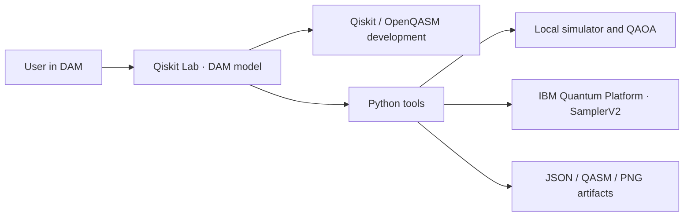
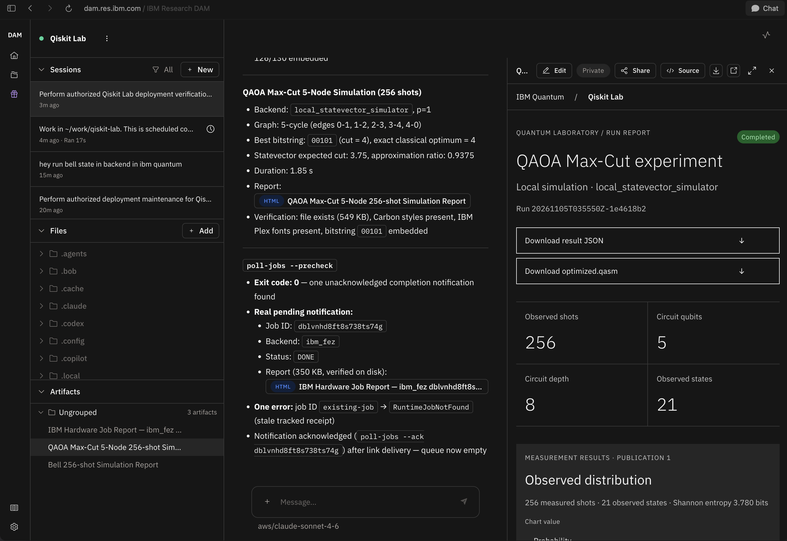
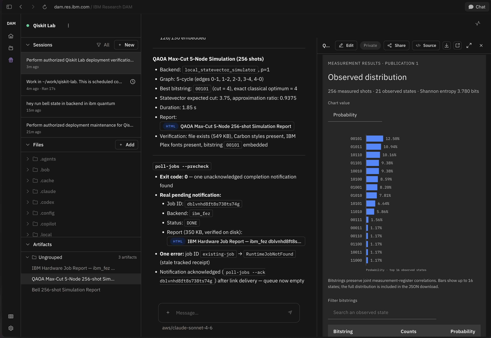
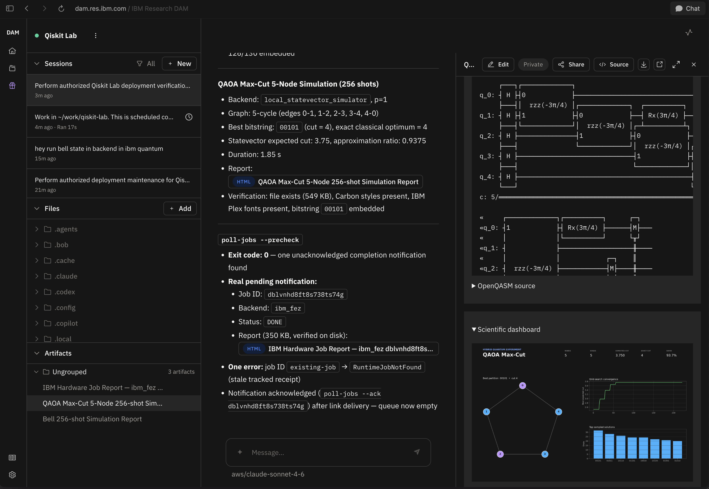

# ⚛️ Qiskit Lab — DAM starter kit

A quantum computing workspace in [DAM](https://dam.res.ibm.com/), connected to **IBM Quantum Platform** through Qiskit Runtime and `SamplerV2`.

Qiskit Lab is a native Python package using the Qiskit SDK for circuit development, simulation, experiments, and hardware execution. DAM supplies the chat model and workspace. The application code lives in `src/qiskit_lab` and calls Qiskit directly.



| Capability | Implementation |
|---|---|
| Orchestration | DAM harness and model; instructions in `AGENTS.md` |
| Developer | Qiskit/OpenQASM development; Bell, GHZ, Grover and Deutsch–Jozsa examples |
| Status | Accessible QPUs, queues, status, operations and topology |
| Computing | Local simulation; ISA transpilation and one fresh `SamplerV2` job when requested |
| Experiment | QAOA Max-Cut p=1, 2–8 nodes, exact classical validation and PNG |
| Results | Automatic Carbon HTML reports, job IDs, joint counts, JSON receipts, QASM, circuit diagrams and distribution comparisons |

Both **`qiskit` and `qiskit-ibm-runtime` are required dependencies** and must be installed before using the tools. QAOA remains experimental; this kit does not implement a general VQE optimizer. Code, documentation and agent responses use English.

## Qiskit Lab in DAM

These screenshots show a five-node QAOA Max-Cut local simulation and its Carbon
HTML report inside DAM.

**Report overview.** Completion status, downloads, shot count and circuit statistics.



**Measurement results.** Observed bitstring probabilities and searchable results.



**Circuit and scientific dashboard.** Circuit source, graph, convergence and sampled solutions.



## Install as a DAM starter kit

The root [`kit.yaml`](kit.yaml) follows the
[official DAM starter-kit format](https://github.com/dam-agents/dam-starter-kits).
It seeds this repository at the catalog's resolved commit, installs the locked
Qiskit SDK environment, advertises the bundled `qiskit-lab` skill, and declares
the two-minute job-report schedule. It uses the platform's default model and
harness selection, plus the IBM network hosts the SDK needs.

The platform runs `bash scripts/dam/install.sh` inside the seeded checkout before
opening onboarding. That command installs home instruction entry points and
`~/.local/bin/qiskit-lab-dam`, which points to the actual checkout. It does not
run a circuit, read credentials, or submit IBM work. The first conversation
follows [`ONBOARDING.md`](ONBOARDING.md): choose local simulation or configure
IBM access using the owner-only hidden Terminal prompt. The platform holds
recurring schedules until onboarding completes; schedules the owner skips or
disables stay that way. No Node.js or local DAM CLI is needed for native install.

Native installation requires a catalog configured on the DAM deployment.
Curated-catalog registration is proposed in
[dam-starter-kits PR #18](https://github.com/dam-agents/dam-starter-kits/pull/18).
After registration and catalog refresh, select **Qiskit Lab** from DAM's
**Starter Kits** page. The current `dam.res.ibm.com` deployment supports
catalog-listed kits; use the CLI deployment below while registration is pending.

An operator can instead configure this repository's root
[`catalog.yaml`](catalog.yaml) as a standalone catalog:

```yaml
starterKits:
  catalogs:
    - name: quantum
      url: https://github.com/BrUn3y/qiskit_lab
```

That catalog addresses the kit as `quantum/qiskit-lab`. Public GitHub catalog
reads are anonymous, so the repository must be public. Preparing the manifests
and registering the catalog are separate steps. Existing regular agents retain
their deployment type.

Validate both manifests offline with `uv run --locked pytest -q tests/test_kit.py`.
The generated upstream schemas and their source commit are documented in
[`dam/README.md`](dam/README.md).

## CLI deployment fallback

Requirements: Python 3.11–3.13 and [uv](https://docs.astral.sh/uv/). Deployment from your machine additionally requires Git, Node.js 20+ and **DAM CLI 0.2.24**. The root `pyproject.toml` declares the required Qiskit SDK packages; `uv.lock` pins the complete environment.

```sh
npm install -g @dam-agents/cli@0.2.24
dam auth login --server https://dam.res.ibm.com
git clone https://github.com/BrUn3y/qiskit_lab.git
cd qiskit_lab
uv sync --locked  # Required: installs Qiskit, IBM Runtime and the qiskit-lab command.
python3 scripts/dam/deploy.py --name 'Qiskit Lab'
```

The installer uses your preferred DAM model provider, creates the agent, configures networking, imports **only Git-tracked files** into `~/work/qiskit-lab`, and starts onboarding. The tool wrapper installs the locked Qiskit environment in DAM before its first command. If the provider offers one model, it selects it automatically; otherwise pass `--model`. It excludes `.git`, credentials, local environments and results. The agent receives the tracked source without needing a GitHub connection.

Options: `--provider 'Provider name'`, `--model ALIAS/MODEL_ID`, `--instance CRN` (not a secret), `--dry-run`, and `--no-run`. The agent and session IDs are saved in `.dam-deploy/deployment.json`, which Git ignores. If deployment fails after creating the agent, use `--existing` to resume deliberately. Use `--existing --agent AGENT_ID` to target an exact agent, including when names are duplicated.

```sh
dam connection list --providers
dam agent models 'Qiskit Lab'
dam agent update 'Qiskit Lab' --model ALIAS/MODEL_ID
```

The CLI fallback creates a regular agent without a starter-kit badge or the
platform's kit onboarding gate. A private repository on `github.com` cannot be
resolved by anonymous catalog readers. A platform-managed
GitHub Enterprise catalog is a separate operator-configured capability.

## Connect IBM Quantum Platform

The first response in a new chat checks the connection. If the account is missing, Qiskit Lab asks you to configure your API key, shows the hidden-entry command, and offers local simulation. It reuses an account that already works. The installer adds these instructions to `~/AGENTS.md` and a native `@AGENTS.md` import to `~/CLAUDE.md`, preserving existing owner instructions in both files. Claude Code can load the startup rules before its first response, as can harnesses that load `AGENTS.md` directly.

1. Open **Qiskit Lab** in [DAM](https://dam.res.ibm.com/) and open its **Terminal**.
2. Run the `setup_command` returned by onboarding yourself in that terminal.
   It includes the actual checkout path. Equivalently, from that checkout run:

   ```sh
   uv run --locked python scripts/dam/configure-quantum.py
   ```

3. Enter your instance CRN and API key from [IBM Quantum Platform](https://quantum.cloud.ibm.com/). The API key uses a hidden prompt. The program verifies QPU access before saving the SDK account in `~/.qiskit/qiskit-ibm.json` with permissions `600`.
4. Return to chat and say: **“Verify the IBM Quantum Platform connection and show my available QPUs.”**

Do not paste the key into chat or commit it to Git. The owner runs credential setup directly. DAM chat password fields also enter the transcript as plain text. DAM `custom-header` connections provide placeholders and cannot insert an API key into IBM IAM's form body. This kit therefore uses a persistent IBM Quantum SDK account. The API key remains on the agent's private disk and must be treated as an agent credential.

| Value | Environment variable |
|---|---|
| IBM Quantum API key | `QISKIT_IBM_TOKEN` |
| Supported API-key alias | `QISKIT_IBM_RUNTIME_APIKEY` |
| Instance CRN | `QISKIT_IBM_INSTANCE` |

The welcome message names these variables. Hidden setup saves the SDK account, so setting variables is optional. If you choose environment configuration, the variables must reach the tool process; exporting them in a separate terminal alone does not configure the chat's tools. The instance also accepts `QISKIT_IBM_RUNTIME_INSTANCE` as an alias. Tools use the `ibm_quantum_platform` channel. Available QPUs depend on the account, instance and region.

## Use the chat

```text
Create a Bell state and simulate it with 1024 shots. Show the circuit and histogram.
Which IBM Quantum computers can I access, and what are their queue lengths?
Show the topology and current status of ibm_BACKEND.
Optimize QAOA Max-Cut for five nodes and compare it with the classical optimum.
Execute the Bell circuit once on real IBM Quantum hardware with 1024 shots.
Check the status and results of job JOB_ID.
```

```sh
dam run 'Qiskit Lab' -p 'Create a Bell state and simulate it with 1024 shots'
dam chat 'Qiskit Lab'
```

Simulation is the default. When you request real hardware, the agent submits one job and returns its ID without waiting through the entire queue. Query the same ID later. The default QPU execution limit is 300 seconds per job; it does not limit cost or queue time. If a submission response is lost, inspect IBM jobs tagged `qiskit-lab-dam` before requesting another submission.

## Automatic Carbon HTML job reports

Every completed simulation, QAOA experiment and terminal hardware job produces
`<job-or-run-id>-<circuit-description>.html` alongside its JSON, QASM and PNG
artifacts. For example, a Bell job produces `JOB_ID-bell-circuit.html`.
The agent automatically displays the report as a rendered DAM HTML artifact and
includes its artifact and workspace file links. If artifact publication is
unavailable, it explains that limitation and preserves the downloadable report.
Use `execute --title 'My circuit'` to label a custom circuit; the default
description comes from the example or QASM filename. `job JOB_ID --title 'My circuit'`
can label an existing job when its circuit is known. Reports use the official **IBM Carbon Design System** Gray 100
theme and bundled IBM Plex fonts. They are self-contained and open offline.

Reports include the recorded job/run ID, backend, status, requested and observed
shots, source/ISA circuit statistics, available timestamps and IBM QPU usage,
SDK versions, measurement charts with probability/count controls, searchable and
paginated state tables, downloadable JSON/OpenQASM, source circuit, and the
scientific dashboard. QAOA reports also include the optimization trace and exact
classical comparison. Missing IBM metadata is marked unavailable.

For IBM hardware, submission still returns immediately. The native kit declares
**Qiskit Lab job reports**, a DAM schedule that checks tracked jobs every **two
minutes**; the private CLI deployer creates its equivalent. The native precheck
uses `bash ~/.local/bin/qiskit-lab-dam poll-jobs --precheck`, so it works wherever
the platform seeds the checkout. It queries existing IDs and writes final HTML when DONE,
ERROR or CANCELLED; it invokes the model only when a report needs to be announced.
No report step submits another hardware job. Failed/cancelled jobs receive a
status report without fabricated counts. Report delivery appears in the DAM
scheduled run; instant delivery into the original chat is not guaranteed.

The schedule uses persistent notifications: after publishing each report artifact
and presenting its link,
the agent acknowledges that ID. An interrupted delivery remains pending. Network
or result-download errors keep the job eligible for the next poll. DAM must be
running and its schedule enabled for automatic checks. Detection occurs at the
next successful poll, not at the exact moment IBM finishes.

```sh
# Inspect one existing job and create its report if it has ended.
uv run --locked qiskit-lab job JOB_ID
# Check all tracked jobs, generate completed reports, and list pending links.
uv run --locked qiskit-lab poll-jobs
# After delivering a report to the owner, acknowledge its notification.
uv run --locked qiskit-lab poll-jobs --ack JOB_ID
```

The default tracked directory is `artifacts/dam/`. If you use a custom hardware
`--output-dir`, use that directory for subsequent job queries and polling and
configure the schedule to match. Reports contain only explicitly recorded job
data; account files and credentials are never embedded.

Carbon CSS and fonts ship inside the Python wheel. Node.js is only needed to
rebuild these checked-in frontend assets, not to run or open reports:

```sh
cd tools/report-assets
npm ci --ignore-scripts
npm run build
```

Third-party licenses and exact asset versions are documented in
`src/qiskit_lab/assets/NOTICE.md`.

## Tools and local development

```sh
uv sync --locked
uv run --locked qiskit-lab --help
bash scripts/dam/setup.sh
scripts/dam/quantum onboarding
scripts/dam/quantum doctor --online
scripts/dam/quantum backends
scripts/dam/quantum backend ibm_BACKEND --dashboard
scripts/dam/quantum execute --example bell --shots 1024
scripts/dam/quantum execute --example ghz --qubits 5
scripts/dam/quantum execute --example grover
scripts/dam/quantum execute --example deutsch-jozsa --qubits 3
scripts/dam/quantum execute --qasm circuit.qasm
scripts/dam/quantum execute --qasm circuit.qasm --hardware --shots 1024
scripts/dam/quantum job JOB_ID --output artifacts/dam/job.json
scripts/dam/quantum qaoa --request 'QAOA Max-Cut on a 5-node graph'
scripts/dam/quantum compare --left LOCAL_RECEIPT.json --right artifacts/dam/job.json
```

Grover uses two qubits and marked state `11`; Deutsch–Jozsa uses a balanced oracle. The model can develop other circuits and export them to QASM. The local simulator supports up to 20 qubits. Joint counts preserve correlations between registers. Compare distributions for the same circuit and register order. Artifacts are saved in `artifacts/dam/<run>/`.

```sh
uv sync --locked
uv run --locked pytest -q
uv run --locked ruff check src tests scripts/dam
uv build
```

CI runs these checks on Linux: algorithms, QASM, joint correlations, QAOA, single-submission QPU contracts, job receipts, safe errors, and first-chat setup behavior. Mock tests do not establish a real IBM connection; use `doctor --online` for that.

## Update an existing deployment

For a kit-created agent, use DAM's **Kit Update** workflow and rerun the
checkout's `bash scripts/dam/install.sh` after the reviewed update to refresh
the locked environment and instruction entry points. Preserve existing results
and owner files. Do not recreate skipped schedules or replace owner-selected
cadence, models or enabled states.

For the private CLI fallback:

```sh
git pull
# Preview the exact target and tracked files without changing DAM.
python3 scripts/dam/deploy.py --existing --agent AGENT_ID --dry-run
python3 scripts/dam/deploy.py --existing --agent AGENT_ID --no-run
dam run AGENT_ID -p 'In ~/work/qiskit-lab verify IBM connectivity; do not submit jobs or run demos.'
```

Existing-agent updates upload each tracked source file with `dam file put`.
They preserve experiment artifacts, job receipts, notifications, the installed
environment, owner files and existing networking rules. Files removed from Git
remain in DAM; review obsolete source files separately. An interrupted upload
can leave mixed source versions: rerun the same update to finish it before using
the kit. The deployer refreshes managed reporting instructions when needed while
preserving the schedule's enabled state, recurrence, timezone and model.
The SDK account stays outside the project directory. Do not delete the agent to
update it: deletion also removes its account and data.

If IBM access fails, check the API key, instance CRN, and rules for `iam.cloud.ibm.com`, `resource-controller.cloud.ibm.com`, `api.global-search-tagging.cloud.ibm.com`, `globalcatalog.cloud.ibm.com`, `quantum.cloud.ibm.com`, and the regional endpoint (`us-east.quantum.cloud.ibm.com` or `eu-de.quantum.cloud.ibm.com`). For another region, add the IBM hostname to the agent's DAM networking rules.

References: [official starter kits](https://github.com/dam-agents/dam-starter-kits) and [kit architecture](https://github.com/dam-agents/dam/blob/main/docs/architecture/starter-kits.md).

## Python package and container

You can also install the package with `python -m pip install .`; this installs the required SDK dependencies and exposes `qiskit-lab`. Run `qiskit-lab doctor` to inspect the installed SDK versions, or `python -m qiskit_lab --help`.

```sh
docker build -t qiskit-lab .
docker run --rm qiskit-lab execute --example bell --shots 256
```

The container installs the locked SDK environment during its build and runs the CLI as a non-root user. It does not start an HTTP server.
