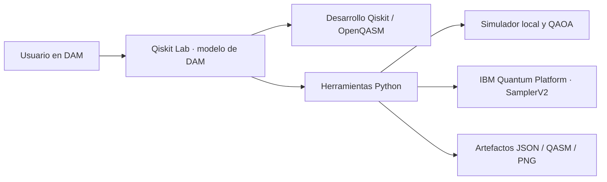

# ⚛️ Qiskit Lab — DAM starter kit

Tu laboratorio cuántico en [DAM](https://dam.res.ibm.com/), conectado a **IBM Quantum Platform** mediante Qiskit Runtime y `SamplerV2`.

Versión privada derivada de [BrUn3y/quantum_lab_agent](https://github.com/BrUn3y/quantum_lab_agent), commit base `9dfdc42`. Conserva los cinco agentes originales y adapta sus funciones a un agente nativo de DAM. Reutiliza directamente el motor QAOA y los renderizadores de topología y resultados. La instalación anterior está en [README.legacy.md](README.legacy.md).



| Función original | Adaptación DAM |
|---|---|
| Lab | Harness y modelo configurados en DAM; instrucciones en `AGENTS.md` |
| Developer | Desarrollo Qiskit/OpenQASM; ejemplos Bell, GHZ, Grover y Deutsch–Jozsa |
| Status | QPUs accesibles, colas, estado, operaciones y topología |
| Computing | Simulación local; transpilación ISA y un nuevo job `SamplerV2` cuando lo solicitas |
| Experiment | QAOA Max-Cut p=1, 2–8 nodos, validación clásica exacta y PNG |
| Resultados | Job ID, conteos conjuntos, recibos JSON, QASM, circuito y comparación de distribuciones |

La ruta DAM no necesita Ollama ni los cinco servidores A2A. QAOA sigue siendo experimental; el kit no implementa un optimizador VQE general. Los gráficos son archivos para DAM; los marcadores Canvas de Agent Stack pertenecen a la ruta anterior.

## Instalar desde el repositorio privado

Requisitos locales: Node.js 20+, CLI **DAM 0.2.24**, Git y Python 3.11+. Dentro del agente se usa `uv`; `dam/uv.lock` fija las dependencias cuánticas sin instalar BeeAI ni Agent Stack.

```sh
npm install -g @dam-agents/cli@0.2.24
dam auth login --server https://dam.res.ibm.com
git clone https://github.com/BrUn3y/qiskit_lab.git
cd qiskit_lab
python3 scripts/dam/deploy.py --name 'Qiskit Lab'
```

El instalador usa tu proveedor de modelos preferido en DAM, crea el agente, configura la red, importa **solo archivos rastreados por Git** a `~/work/qiskit-lab` e inicia el onboarding. Si el proveedor ofrece un solo modelo, lo configura automáticamente; si hay varios, indica `--model`. No envía `.git`, credenciales, entornos locales ni resultados. El agente recibe el código privado sin necesitar una conexión GitHub.

Opciones: `--provider 'Nombre del proveedor'`, `--model ALIAS/ID_MODELO`, `--instance CRN` (no secreto), `--no-run`. El ID y la sesión quedan en `.dam-deploy/deployment.json`, ignorado por Git. Si falla tras crear el agente, usa `--existing` para continuar deliberadamente.

```sh
dam connection list --providers
dam agent models 'Qiskit Lab'
dam agent update 'Qiskit Lab' --model ALIAS/ID_MODELO
```

**Límite de DAM:** “añadir kit por enlace” solo admite repositorios públicos de GitHub. No pegues el enlace privado en ese formulario. El instalador usa la ruta soportada por la CLI y crea un agente normal, sin etiqueta de starter kit. `kit.yaml` conserva el formato oficial y puede añadirse a un catálogo administrado con acceso al repositorio; eso requiere al administrador del despliegue.

## Conectar IBM Quantum Platform

La primera respuesta de un chat nuevo comprueba la conexión. Si falta la cuenta,
Qiskit Lab te pide configurar tu API key y te muestra el comando de entrada oculta;
también ofrece continuar con el simulador. Si la cuenta ya funciona, la reutiliza.
El instalador añade esta instrucción a `~/AGENTS.md`, conservando las instrucciones
existentes, para que funcione incluso al abrir una conversación nueva desde DAM.
No introduce campos de contraseña en el chat: DAM también guarda sus valores en
el historial. La clave se introduce directamente en la Terminal del agente.

1. Abre **Qiskit Lab** en [DAM](https://dam.res.ibm.com/) y entra en su **Terminal**.
2. Ejecuta tú mismo, directamente allí:

   ```sh
   cd ~/work/qiskit-lab
   uv run --locked --project dam python scripts/dam/configure-quantum.py
   ```

3. Introduce el CRN de tu instancia y la API key de [IBM Quantum Platform](https://quantum.cloud.ibm.com/). La clave se pide con prompt oculto. El programa verifica acceso a QPUs antes de guardar la cuenta del SDK en `~/.qiskit/qiskit-ibm.json`, con permisos `600`.
4. Vuelve al chat y escribe: **“Verifica la conexión a IBM Quantum Platform y muéstrame las QPUs disponibles.”**

No pegues la clave en el chat ni la incluyas en Git. Esta configuración la ejecuta el propietario, no el modelo. Las conexiones `custom-header` de DAM entregan placeholders y no sustituyen la API key en el formulario de IBM IAM. Por eso se usa la cuenta persistente del SDK. La API key queda en el disco privado del agente y debe tratarse como credencial de ese agente.

| Valor | Variable de entorno |
|---|---|
| API key de IBM Quantum | `QISKIT_IBM_TOKEN` |
| Alias admitido para la API key | `QISKIT_IBM_RUNTIME_APIKEY` |
| CRN de la instancia | `QISKIT_IBM_INSTANCE` |

La bienvenida menciona estas variables. El prompt oculto guarda la cuenta del SDK,
por lo que no requiere definirlas. Si eliges variables, deben estar disponibles
en el proceso que ejecuta las herramientas; un `export` en otra terminal por sí
solo no configura las herramientas del chat.

Los comandos usan el canal `ibm_quantum_platform`. Para ejecución local también admiten `QISKIT_IBM_TOKEN` o `QISKIT_IBM_RUNTIME_APIKEY`, y opcionalmente `QISKIT_IBM_INSTANCE` / `QISKIT_IBM_RUNTIME_INSTANCE`, sin imprimirlos. Las QPUs accesibles dependen de tu cuenta, instancia y región.

## Usarlo desde el chat

```text
Crea un estado Bell y simúlalo con 1024 shots. Muéstrame circuito e histograma.
¿Qué computadoras de IBM Quantum tengo disponibles y cómo están sus colas?
Muéstrame la topología y el estado actual de ibm_NOMBRE.
Optimiza QAOA Max-Cut para cinco nodos y compáralo con el óptimo clásico.
Ejecuta una vez el circuito Bell en hardware real de IBM Quantum con 1024 shots.
Consulta el estado y los resultados del job ID_QUE_DEVOLVIO_IBM.
```

```sh
dam run 'Qiskit Lab' -p 'Crea un estado Bell y simúlalo con 1024 shots'
dam chat 'Qiskit Lab'
```

La simulación es el comportamiento predeterminado. Cuando pides hardware real, se envía un job y se devuelve el Job ID sin esperar toda la cola. Consulta después ese mismo ID. El límite predeterminado de ejecución QPU es 300 segundos por job; no limita el costo ni la espera. Si se pierde la respuesta de un envío, revisa en IBM los jobs etiquetados `qiskit-lab-dam` antes de solicitar otro.

## Herramientas y desarrollo local

```sh
bash scripts/dam/setup.sh
scripts/dam/quantum doctor --online
scripts/dam/quantum backends
scripts/dam/quantum backend ibm_NOMBRE --dashboard
scripts/dam/quantum execute --example bell --shots 1024
scripts/dam/quantum execute --example ghz --qubits 5
scripts/dam/quantum execute --example grover
scripts/dam/quantum execute --example deutsch-jozsa --qubits 3
scripts/dam/quantum execute --qasm circuito.qasm
scripts/dam/quantum execute --qasm circuito.qasm --hardware --shots 1024
scripts/dam/quantum job JOB_ID --output artifacts/dam/job.json
scripts/dam/quantum qaoa --request 'QAOA Max-Cut on a 5-node graph'
scripts/dam/quantum compare --left RECIBO_LOCAL.json --right artifacts/dam/job.json
```

Grover usa dos qubits y el estado marcado `11`; Deutsch–Jozsa usa un oráculo balanceado. El modelo puede desarrollar otros circuitos y exportarlos a QASM. El simulador limita el circuito a 20 qubits. Los conteos de varios registros conservan sus correlaciones. Compara distribuciones del mismo circuito y orden de registros. Artefactos: `artifacts/dam/<run>/`.

```sh
uv sync --locked --project dam
uv run --locked --project dam pytest dam/tests -q
uv run --locked --project dam ruff check dam scripts/dam
```

CI ejecuta esas pruebas en Linux: algoritmos, QASM, correlaciones, QAOA, contratos de envío QPU sin reintentos y persistencia del Job ID, y errores sin exponer credenciales. Los mocks no verifican la conexión IBM real; usa `doctor --online`.

## Actualizar

```sh
git pull
python3 scripts/dam/deploy.py --name 'Qiskit Lab' --existing --no-run
dam run 'Qiskit Lab' -p 'En ~/work/qiskit-lab ejecuta bash scripts/dam/setup.sh y verifica IBM; no envíes jobs.'
```

En DAM 0.2.24 la importación puede sustituir la carpeta de código completa. Descarga antes los artefactos que quieras conservar con `dam file get`. La cuenta del SDK queda fuera de esa carpeta. No elimines el agente para actualizar: eliminarlo también borra su cuenta y datos.

Si falla IBM, revisa API key, CRN y reglas para `iam.cloud.ibm.com`, `resource-controller.cloud.ibm.com`, `quantum.cloud.ibm.com` y el endpoint regional (`us-east.quantum.cloud.ibm.com` o `eu-de.quantum.cloud.ibm.com`). Para otra región agrega el hostname indicado por IBM a las reglas de DAM.

Referencias: [starter kits oficiales](https://github.com/dam-agents/dam-starter-kits), [arquitectura de kits](https://github.com/dam-agents/dam/blob/main/docs/architecture/starter-kits.md).
