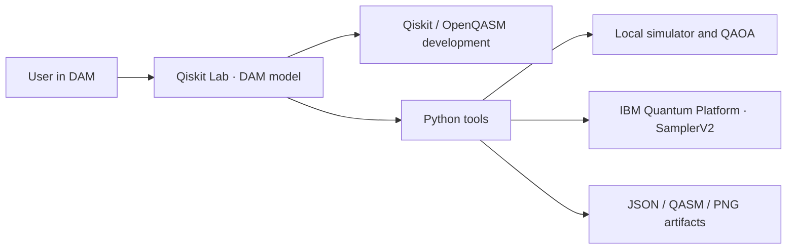

# ⚛️ Qiskit Lab — DAM starter kit

A quantum computing workspace in [DAM](https://dam.res.ibm.com/), connected to **IBM Quantum Platform** through Qiskit Runtime and `SamplerV2`.

Qiskit Lab is a native Python package using the Qiskit SDK for circuit development, simulation, experiments, and hardware execution. DAM supplies the chat model and workspace. The application code lives in `src/qiskit_lab` and calls Qiskit directly.



| Capability | Implementation |
|---|---|
| Orchestration | DAM harness and model; instructions in `AGENTS.md` |
| Developer | Qiskit/OpenQASM development; Bell, GHZ, Grover and Deutsch–Jozsa examples |
| Status | Accessible QPUs, queues, status, operations and topology |
| Computing | Local simulation; ISA transpilation and one fresh `SamplerV2` job when requested |
| Experiment | QAOA Max-Cut p=1, 2–8 nodes, exact classical validation and PNG |
| Results | Job IDs, joint counts, JSON receipts, QASM, circuit diagrams and distribution comparisons |

Both **`qiskit` and `qiskit-ibm-runtime` are required dependencies** and must be installed before using the tools. QAOA remains experimental; this kit does not implement a general VQE optimizer. Code, documentation and agent responses use English.

## Install from the private repository

Requirements: Python 3.11–3.13 and [uv](https://docs.astral.sh/uv/). Deployment from your machine additionally requires Git, Node.js 20+ and **DAM CLI 0.2.24**. The root `pyproject.toml` declares the required Qiskit SDK packages; `uv.lock` pins the complete environment.

```sh
npm install -g @dam-agents/cli@0.2.24
dam auth login --server https://dam.res.ibm.com
git clone https://github.com/BrUn3y/qiskit_lab.git
cd qiskit_lab
uv sync --locked  # Required: installs Qiskit, IBM Runtime and the qiskit-lab command.
python3 scripts/dam/deploy.py --name 'Qiskit Lab'
```

The installer uses your preferred DAM model provider, creates the agent, configures networking, imports **only Git-tracked files** into `~/work/qiskit-lab`, and starts onboarding. The tool wrapper installs the locked Qiskit environment in DAM before its first command. If the provider offers one model, it selects it automatically; otherwise pass `--model`. It excludes `.git`, credentials, local environments and results. The agent receives the private source without needing a GitHub connection.

Options: `--provider 'Provider name'`, `--model ALIAS/MODEL_ID`, `--instance CRN` (not a secret), and `--no-run`. The agent and session IDs are saved in `.dam-deploy/deployment.json`, which Git ignores. If deployment fails after creating the agent, use `--existing` to resume deliberately.

```sh
dam connection list --providers
dam agent models 'Qiskit Lab'
dam agent update 'Qiskit Lab' --model ALIAS/MODEL_ID
```

**DAM limitation:** adding a kit by repository link supports only public GitHub repositories. Do not paste this private URL into that form. The installer uses the supported CLI path and creates a regular agent without a starter-kit badge. `kit.yaml` follows the official format and can be added to an administrator-managed catalog with repository access.

## Connect IBM Quantum Platform

The first response in a new chat checks the connection. If the account is missing, Qiskit Lab asks you to configure your API key, shows the hidden-entry command, and offers local simulation. It reuses an account that already works. The installer adds these instructions to `~/AGENTS.md` while preserving existing instructions, so they also apply to new DAM conversations.

1. Open **Qiskit Lab** in [DAM](https://dam.res.ibm.com/) and open its **Terminal**.
2. Run this command yourself in that terminal:

   ```sh
   cd ~/work/qiskit-lab
   uv run --locked python scripts/dam/configure-quantum.py
   ```

3. Enter your instance CRN and API key from [IBM Quantum Platform](https://quantum.cloud.ibm.com/). The API key uses a hidden prompt. The program verifies QPU access before saving the SDK account in `~/.qiskit/qiskit-ibm.json` with permissions `600`.
4. Return to chat and say: **“Verify the IBM Quantum Platform connection and show my available QPUs.”**

Do not paste the key into chat or commit it to Git. The owner runs credential setup directly. DAM chat password fields also enter the transcript as plain text. DAM `custom-header` connections provide placeholders and cannot insert an API key into IBM IAM's form body. This kit therefore uses a persistent IBM Quantum SDK account. The API key remains on the agent's private disk and must be treated as an agent credential.

| Value | Environment variable |
|---|---|
| IBM Quantum API key | `QISKIT_IBM_TOKEN` |
| Supported API-key alias | `QISKIT_IBM_RUNTIME_APIKEY` |
| Instance CRN | `QISKIT_IBM_INSTANCE` |

The welcome message names these variables. Hidden setup saves the SDK account, so setting variables is optional. If you choose environment configuration, the variables must reach the tool process; exporting them in a separate terminal alone does not configure the chat's tools. The instance also accepts `QISKIT_IBM_RUNTIME_INSTANCE` as an alias. Tools use the `ibm_quantum_platform` channel. Available QPUs depend on the account, instance and region.

## Use the chat

```text
Create a Bell state and simulate it with 1024 shots. Show the circuit and histogram.
Which IBM Quantum computers can I access, and what are their queue lengths?
Show the topology and current status of ibm_BACKEND.
Optimize QAOA Max-Cut for five nodes and compare it with the classical optimum.
Execute the Bell circuit once on real IBM Quantum hardware with 1024 shots.
Check the status and results of job JOB_ID.
```

```sh
dam run 'Qiskit Lab' -p 'Create a Bell state and simulate it with 1024 shots'
dam chat 'Qiskit Lab'
```

Simulation is the default. When you request real hardware, the agent submits one job and returns its ID without waiting through the entire queue. Query the same ID later. The default QPU execution limit is 300 seconds per job; it does not limit cost or queue time. If a submission response is lost, inspect IBM jobs tagged `qiskit-lab-dam` before requesting another submission.

## Tools and local development

```sh
uv sync --locked
uv run --locked qiskit-lab --help
bash scripts/dam/setup.sh
scripts/dam/quantum onboarding
scripts/dam/quantum doctor --online
scripts/dam/quantum backends
scripts/dam/quantum backend ibm_BACKEND --dashboard
scripts/dam/quantum execute --example bell --shots 1024
scripts/dam/quantum execute --example ghz --qubits 5
scripts/dam/quantum execute --example grover
scripts/dam/quantum execute --example deutsch-jozsa --qubits 3
scripts/dam/quantum execute --qasm circuit.qasm
scripts/dam/quantum execute --qasm circuit.qasm --hardware --shots 1024
scripts/dam/quantum job JOB_ID --output artifacts/dam/job.json
scripts/dam/quantum qaoa --request 'QAOA Max-Cut on a 5-node graph'
scripts/dam/quantum compare --left LOCAL_RECEIPT.json --right artifacts/dam/job.json
```

Grover uses two qubits and marked state `11`; Deutsch–Jozsa uses a balanced oracle. The model can develop other circuits and export them to QASM. The local simulator supports up to 20 qubits. Joint counts preserve correlations between registers. Compare distributions for the same circuit and register order. Artifacts are saved in `artifacts/dam/<run>/`.

```sh
uv sync --locked
uv run --locked pytest -q
uv run --locked ruff check src tests scripts/dam
uv build
```

CI runs these checks on Linux: algorithms, QASM, joint correlations, QAOA, single-submission QPU contracts, job receipts, safe errors, and first-chat setup behavior. Mock tests do not establish a real IBM connection; use `doctor --online` for that.

## Update an existing deployment

```sh
git pull
python3 scripts/dam/deploy.py --name 'Qiskit Lab' --existing --no-run
dam run 'Qiskit Lab' -p 'In ~/work/qiskit-lab run bash scripts/dam/setup.sh and verify IBM connectivity; do not submit jobs.'
```

On DAM 0.2.24, importing can replace the entire source directory. Download artifacts you want to retain with `dam file get` first. The SDK account is outside that directory. Do not delete the agent to update it: deletion also removes its account and data.

If IBM access fails, check the API key, instance CRN, and rules for `iam.cloud.ibm.com`, `resource-controller.cloud.ibm.com`, `api.global-search-tagging.cloud.ibm.com`, `globalcatalog.cloud.ibm.com`, `quantum.cloud.ibm.com`, and the regional endpoint (`us-east.quantum.cloud.ibm.com` or `eu-de.quantum.cloud.ibm.com`). For another region, add the IBM hostname to the agent's DAM networking rules.

References: [official starter kits](https://github.com/dam-agents/dam-starter-kits) and [kit architecture](https://github.com/dam-agents/dam/blob/main/docs/architecture/starter-kits.md).

## Python package and container

You can also install the package with `python -m pip install .`; this installs the required SDK dependencies and exposes `qiskit-lab`. Run `qiskit-lab doctor` to inspect the installed SDK versions, or `python -m qiskit_lab --help`.

```sh
docker build -t qiskit-lab .
docker run --rm qiskit-lab execute --example bell --shots 256
```

The container installs the locked SDK environment during its build and runs the CLI as a non-root user. It does not start an HTTP server.
